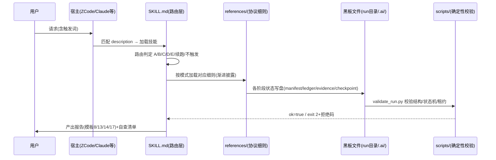

# project-relay（个人制作-项目接手.skill）拆解学习报告

> 档位：**标准** · 覆盖率：**100%**（分母=10 个候选模块，模块口径见 §4）· 日期 2026-10-25 · 分析对象 commit `0411cb3373cbbf7f161227119b9009992ec86b03`（v3.3.0，本地 main，与远程 GitHub 同步）· 未分析范围：`reports/` 下 5 份迭代报告与 prior-art-research 未逐字深读（仅读 creation-handoff 全文 + 其余结构扫描）；`参考资料/`（gitignore 排除、不随包发布）与 `evals/results/`（历史评估存档）按 vendor 口径排除。

## TL;DR（5 条）

1. **这是一个"协议工程"产品，不是代码项目**：整个技能 = 1 份主协议（SKILL.md，174 行正文）+ 9 份细则（references，74,780 字节）+ 4 个零依赖校验脚本（21KB Python）+ 评测资产（58 例触发合同 + 12 场景人工量表）。核心资产是**方法论本身**：5+1 模式、八不变量、15 条设计公理、黑板协议、真相层级、四级证据分级。
2. **工程质量高且自洽**：manifest 声明的 10 条 release_gates **本次全部实测通过**（validate_skill 0 failures；触发评测 58/58；validate_run 正例 exit 0、两类负例 exit 2 且报错精准；check_license 自检 MIT/MIT 与致谢声明互证）。文档-代码一致性极好——抽验的所有交叉引用（文件名、CLI 签名、字段名、平台清单、预算数字）全部对得上。
3. **最大的特色是"诚实边界"**：README 与 creation-handoff 把每个能力显式分为 **validated**（可复现命令证明）与 **hypothesis**（依赖宿主与模型、待真实测试），把"离线评测只能证明结构、不能证明模型遵守流程"写进了产品本体（README:100-102）。这在技能生态中少见。
4. **发现 10 条 Advisory 级改进点**（无 Blocking）：最值得修的是 templates.md 两处嵌套代码块 fence 冲突（渲染歧义，`references/templates.md:173-236`、`346-375`）、readme-EN 两处标题与正文挤行（`readme-EN:33,35`）、Python 版本下限未声明。详见 §10。
5. **核心风险是根本性的且已被作者声明**：P0–P8/H0–H7 的**过程纪律依赖模型自觉**，确定性脚本只能兜住可机检的部分（黑板文件结构、状态机、触发词法）。缓解方向正确（把能下放给脚本的都下放了），剩余部分是整个 Agent 技能生态的共性边界，不是本技能独有的缺陷。

## 1. 项目概述

**一句话定位**：给 AI Agent 用的"跨会话项目接力"操作协议——模型会换、上下文会丢、额度会用完，所以把可执行记忆写成仓库里的文件，而不是留在聊天框里（`SKILL.md:13` 核心公理）。

**形态**：Agent Skill 包（Anthropic Agent Skills 规范：SKILL.md + frontmatter + 按需加载的 references），经 `npx skills add hoshinohatsuka/project-relay-Skill` 安装（`README.md:59`）。本仓库即开发仓，HEAD `0411cb3` 与 `C:\Users\hoshi\.zcode\skills\project-relay` 安装副本内容逐字节一致（仅 CRLF/LF 差异，本次对比验证）。

**规模**（实测）：

| 组件 | 体量 | 说明 |
|---|---|---|
| SKILL.md | 25,644 B（正文 174 行） | 唯一入口提示词，5+1 模式路由 |
| references/（9 个） | 74,780 B | 各模式细则与全部产出模板 |
| scripts/（4 个） | ~21 KB | 纯标准库、离线、只读校验器 |
| evals/ | 计划+58 例触发合同+12 场景量表+正反 fixtures | 确定性回归 |
| reports/（9 个） | 设计史与迭代记录 | validated/hypothesis 分级 |
| manifest.json / interface.yaml | 1.9 KB / 3.3 KB | 发布门禁声明 / 多宿主接口 |

## 2. 数据流分析（技能如何工作）



关键机制：**黑板协议**（`SKILL.md:117-131`）——跨 Agent/跨时段状态只通过 `oss-teardown/<run-id>/` 内的 run-manifest / task-ledger / evidence-ledger / checkpoints 交换，Agent 间传"路径+摘要"不传大段文本（`multi-agent-handoff.md:25`）；`validate_run.py:23-29` 用显式转移表把任务状态机变成机器可拒收的合同。

## 3. 基准源码参考（四层，证据分级 L1-L4）

| 层 | 内容 | 证据 |
|---|---|---|
| **上游框架** | Anthropic Agent Skills 规范（SKILL.md frontmatter、渐进披露三段式）；skills CLI 安装通道 | L1：`SKILL.md:1-9` frontmatter、`README.md:57-71` |
| **脚手架来源** | qiaomu-meta-skill 体系：`reports/skill-ir.json` schema 标 `2.0.0-qiaomu-lite`；`evaluate_triggers.py:26` 注释自认 "Mirrors the qiaomu evaluator"；validate_skill 的包结构合同风格同源 | L1：文件与注释直证 |
| **参考项目** | ①Guan-Yep/open-source-llm-analyzer（howPrompt 系）→四路扫描改编（`workflow-detail.md:3`）；②yzddmr6/repo-analyzer→档位覆盖率/并行 Worker；③Cline Memory Bank、agents.md、AI Hero /handoff→常驻/在途二分与模式C；④Together AI plan-divide-conquer→强规划弱执行；⑤lee-to/aif-handoff→v3.2/v3.3 九条理念借鉴（B1-B8/B10） | L1：本地存有 aif-handoff 完整副本可供比对；L2：`manifest.json:10`、`README.md:120-121` 归因声明；L3：网络验证 repo-analyzer（464★）与 aif-handoff 真实存在 |
| **自研核心** | 八不变量、真相层级仲裁序、需求→模块映射口径、四级证据分级 L1-L4、D0 双项目锚定硬门禁、"默认仅理念/抄代码需显式选择"、五类复述、三思维清单、无技能接手协议附录 | L2：`creation-handoff.md:24` invent 行自述；方法论自洽性本次拆解独立复核成立 |

## 4. 需求→模块映射

**模块边界规则（先声明口径再数数）**：模块 = 围绕同一职责、有清晰入口（被 SKILL.md 路由引用 / 被宿主加载 / 被脚本 CLI 调用）的功能单元；**模块 ≠ 目录**。同一文件可承载多模块（如 handoff-guide.md 同时是模块 3 与模块 4 的细则载体），按职责归一、不重复计数。

**需求从哪来**：README 六模式用法表倒推 + manifest release_gates 声明的义务 + SKILL.md 路由节。

| 需求 | 模块数 | 模块（职责） | 关键文件 |
|---|---|---|---|
| R1 路由与触发（5+1 模式判定、不触发边界） | 1 | 路由/触发合同 | `SKILL.md:3,34-44`、`interface.yaml:5-29`、`evaluate_triggers.py`+`trigger_cases.json` |
| R2 模式A 拆解学习（P0-P8） | 1 | 模式A 引擎 | `SKILL.md:46-58`、`workflow-detail.md`、`teardown-guide.md`、`community-research.md`、`templates.md:43-112` |
| R3 模式B 项目接手（H0-H7） | 1 | 模式B 引擎 | `SKILL.md:60-71`、`handoff-guide.md:1-105`、`templates.md:114-167` |
| R4 模式C 交棒冻结（C0-C5） | 1 | 模式C 引擎 | `SKILL.md:73-84`、`handoff-guide.md:107-149`、`templates.md:169-238` |
| R5 模式D 借鉴计划（D0-D8） | 1 | 模式D 引擎 | `SKILL.md:86-100`、`borrow-plan.md`、`check_license.py`、`templates.md:240-308` |
| R6 模式E 教学模式（E0-E7） | 1 | 模式E 引擎 | `SKILL.md:102-115`、`learning-plan.md`、`templates.md:310-357` |
| R7 断点续跑（checkpoint 恢复） | 2 | 黑板/状态机 + 路由 | `multi-agent-handoff.md:52`、`validate_run.py:83-85`（schema 不匹配拒绝自动续跑）、`SKILL.md:41` |
| R8 多 Agent 黑板协作 | 1 | 黑板/状态机 | `SKILL.md:117-131`、`multi-agent-handoff.md`、`validate_run.py`、`templates.md:5-41` |
| R9 安全与门禁（只读/注入/许可证/秘密） | 2 | 安全规则（协议）+ check_license（机检） | `SKILL.md:138-146`、`workflow-detail.md:5-10`、`interface.yaml:40-50`、`check_license.py` |
| R10 质量治理（发布门禁与评测） | 1 | 包治理 | `manifest.json:12-24`、`validate_skill.py`、`EVALUATION_PLAN.md`、`scenario_matrix.json` |
| R11 安装与多宿主兼容 | 1 | 安装/发现兼容 | `README.md:55-73`、`interface.yaml:30-39`、`validate_skill.py:17-22`（必需文件合同） |

**映射结论**：11 条需求全覆盖，无"文档宣称但未找到实现"项；一个模块服务多需求（R7 复用黑板模块与路由模块）是正常复用信号；无需求散落 8+ 模块的坏味道。

## 5. 模块选型矩阵（协议设计选型，理由按四级证据分级）

| 选型点 | 决策 | 选择理由 | 替代品 | 权衡 | 证据级 |
|---|---|---|---|---|---|
| 触发评测 | 词法合同（关键词打分）58 例 | 离线、确定性、可回归；不冒充语义路由评测 | LLM-as-judge 触发评测 | 测不了宿主真实语义路由——脚本 docstring 自己声明 "not evidence of a host router's semantic matching behavior" | L1 `evaluate_triggers.py:2-6,54` |
| 状态校验 | 纯标准库 JSON/JSONL | 零依赖安装、离线可跑、不给宿主添供应链风险 | SQLite/数据库黑板 | 表达力弱于数据库，但人可读、git 可 diff | L1 各脚本 docstring；L2 `README.md:73` 前置条件 |
| 许可证判定 | 脚本只做结构检测，判断权归模型+用户 | 法律判断不可自动化，显式分工防 AI 越权拍板 | 集成 SPDX 库自动判 | 多一步人工，换来"绝不静默放行" | L1 `check_license.py:6-13`；L2 `borrow-plan.md:66-74` |
| description 长度 | 2,260 字节超长（五模式触发词全埋入） | 换取词法触发召回（58 例全过）与跨宿主关键词兼容 | 官方建议的短 description | 与官方"短 description"最佳实践张力（见 §8）；作者 v3.1.0 拍板"1M 上下文时代以精确性优先" | L1 实测字节数；L2 `creation-handoff.md:59` |
| 黑板介质 | 目标项目内 Markdown/JSON 文件 | 与仓库共存、git 可审计、任何工具可读 | 外部数据库/MCP 服务 | 需要文件写权限；`.gitignore` 需排除 run 目录 | L4 分析推断 + L2 公理1 `relay-principles.md:7` |
| 单 SKILL.md 五模式 | 一个入口协议承载 A-E | 五模式共享同一理解引擎（P1-P3），拆分则重复维护且路由易冲突 | 每模式一个独立 Skill | SKILL.md 偏重（25.6KB），靠渐进披露兜底 | L4 分析推断；L2 `SKILL.md:104`（E 模式"引擎同 A"自述） |
| 评分口径 | 触发分母封顶 min(5, max(3, 组数)) | 防模式D 多概念组稀释最低正向信号（两命中=0.4 > 阈值 0.333） | 不封顶平均分 | 阈值语义依赖此封顶，需与用例同步演化 | L1 `evaluate_triggers.py:22-28` 注释直证 |

## 6. 解耦与性能评估

### 6.1 解耦（可 review 性）

- **接口边界 ✔**：SKILL.md → references 单向下沉引用；references 相互引用构成 DAG（templates 被各模式细则引用，无回环）；宿主只接触 SKILL.md frontmatter + interface.yaml。
- **依赖方向 ✔**：4 个脚本只读包内文件与用户给定的 run 目录，不 import 第三方、不访问网络（docstring 声明 + 本次通读证实）。
- **可测试性 ✔（本技能最强项）**：可机检的合同全部脚本化并有正反 fixtures——路径逃逸、非法状态跃迁、坏时间戳、缺 reason 都有拒收用例，本次实跑全部按预期 exit 2。
- **替换成本 ✔**：interface.yaml 的 `compatibility.adapter_targets` + 模板 13 尾部"无技能接手协议"附录，让协议本身不锁死在单一宿主（`interface.yaml:30-39`、`templates.md:230-236`）。
- **全局 mutable 状态**：不适用（无运行时常驻状态）。

### 6.2 性能（对本技能 = 上下文/加载成本）静态审计

| 项 | 实测 | 定性 | 说明 |
|---|---|---|---|
| description 常驻成本 | 2,260 B | 中 | 每次路由决策都进宿主上下文；为触发召回付出的固定税 |
| SKILL.md 触发后全量加载 | 25,644 B（174 行） | 中 | 在 manifest 预算 30,000 B 内（`manifest.json:25`）；行数远低于官方 500 行上限；但个别宿主对 SKILL.md 读取有字节上限的社区线索存在（deepagents #2446，L3 线索级）→ **可验证假设**：在目标宿主实测加载完整性 |
| references 按需加载 | 74,780 B 全量，单模式实载 ~15-20 KB | 低 | 渐进披露设计正确，只有被路由到的细则进上下文 |
| 脚本运行成本 | 毫秒级、零依赖 | 低 | 无安装、无网络 |
| 产出物成本 | 黑板文件 + 报告按档位增长 | 低 | run 目录 gitignore 排除（`.gitignore:11`），不污染包体 |

未发现阻塞/N+1/重复计算类问题（不适用——无运行时数据通路）。

## 7. 提示词与 Agent 设计（P5 四路互补扫描，对象=本技能自身）

本技能自身就是"提示词产品"，故 P5 对其自身执行（对目标项目执行时的四路方法见 `workflow-detail.md:39-60`）：

- **路1 文件名模式** ✔：SKILL.md 是唯一入口提示词；SKILL.md 与 README 引用的 9 个 references 文件全部存在（逐个核对）；无孤儿细则（9 个文件全部被 SKILL.md:176-181 或 README 引用）。
- **路2 变量与占位符** ✔：双轨制且有声明——`{variable}` 保留给目标项目提示词翻译（`workflow-detail.md:58`），`<>` 用于本技能模板占位（`templates.md:3` 明文声明）；SKILL.md 内 `<run-id>`/`<主题>`/`<日期>` 用法一致。
- **路3 API/CLI 签名** ✔：4 个脚本的实际 argparse 签名（validate_skill 无参、evaluate_triggers 无参、validate_run `<run_dir>`、check_license `<user_project> <reference_project>`）与 SKILL.md:183-184、README.md:88-94 的文档完全一致。
- **路4 配置与资产** ✔：manifest.json 10 条 release_gates 与脚本行为一一对应（本次实跑验证 6 条核心 gate）；interface.yaml 的 6 个 mode id 与 validate_skill.py:61 的强制 token 清单一致——**接口自身被自己的校验器约束**，这是好设计。

**已检查范围**：四路全覆盖，无未检查范围。**不宣称**"提示词零歧义"——184 行协议在真实模型上的逐条遵守率属于宿主侧行为（与 README:102 声明一致）。

## 8. 社区对标与口碑（P6，4/4 查询预算）

| # | 查询方向 | 结论（来源类型） | 证据 |
|---|---|---|---|
| 1 | Agent Skills 官方最佳实践 | 官方建议 SKILL.md body <500 行（本技能 174 行 ✔）、description 保持短以便路由（本技能 2,260 B，**有意偏离**，作者已拍板留痕） | 官方文档，platform.claude.com，2026-10-25 访问，可访问 |
| 2 | handoff/memory 生态对标 | Cline Memory Bank、AI Hero /handoff、Agent-Handover-Demo 等均为**单点**交接/记忆方案；"五模式 + 黑板状态机 + 许可证门禁"的**组合**在检索范围内未见同类先行 | 官方博客/社区文章多篇，2026-10-25 访问，可访问；"无同类"判定为 L4 推断（仅限检索范围） |
| 3 | SKILL.md 长度/触发已知问题 | 社区存在"SKILL.md 加载被截断"的宿主问题线索（deepagents issue #2446）；"configs 不校验静默失败"讨论——本技能用确定性脚本治理恰是对症方向 | GitHub issue/社区帖，2026-10-25 访问，摘要级证据（未逐帖核原文） |
| 4 | 上游引用真实性验证 | yzddmr6/repo-analyzer（~464★）与 lee-to/aif-handoff 均真实存在，与致谢一致；**Guan-Yep/open-source-llm-analyzer 检索不到** | GitHub 检索，2026-10-25 访问，可访问 |

**missing evidence 清单**：
- `Guan-Yep/open-source-llm-analyzer`（四路扫描的改编上游，`workflow-detail.md:3`）网络检索未命中——可能改名/私有/搜索引擎覆盖不足，**只记失败不推断**（本技能自己的 P6 纪律同样适用于本次分析）。
- 宿主自动触发的语义路由实测；真实模型在五模式中的端到端遵守率；收敛门在真实复核中的效果——作者已全部自declared 为 hypothesis（`README.md:102`），本次独立核实其声明与事实边界一致。
- 知乎/小红书/X 等中文社区对本技能的口碑：未检索（预算分配给了对标与上游验证；本技能 2026-09 才发布 v3.x，社区口碑存在性本身存疑）。

## 9. 学习路径（如何学会并复刻这个技能）

**阅读顺序（依赖序）**：
1. `references/relay-principles.md`（15 公理）——先懂"为什么"，再读"怎么做"。
2. `SKILL.md` 全文——路由表 + 八不变量 + 各模式骨架；对照 `README.md` 的六模式"用途/触发/红线"三行表最快入门。
3. `references/templates.md`——所有产物的机器格式规格（黑板文件、交接包、借鉴计划、学习路径）。
4. `scripts/validate_run.py`——**最有教学价值的单文件**：看状态机转移表（:23-29）、租约/审计字段校验（:127-149）如何把"协议纪律"变成"机器拒收"。
5. `reports/creation-handoff.md`——keep/adapt/reject/invent 四分法的借鉴方法论（本技能自己用模式D 借鉴 aif-handoff 的过程记录，是模式D 的最佳实例）。

**复刻练习（举一反三，不代答）**：
- **Use**：装好技能，对一个真实 GitHub 小项目跑模式A 快速档，检查 LEARNING_REPORT 是否带覆盖率分母。
- **Modify**：给模式A 增加一个"P9 结果回访"阶段，验证八不变量第 7 条（checkpoint 恢复）是否仍然成立。
- **Debug**：修复本报告 §10 发现的 A-01（templates.md 嵌套 fence）与 A-02（readme-EN 标题），重跑 `validate_skill.py` 确认 0 failures——注意 fence 修复不影响机检合同，思考为什么（校验器不覆盖渲染层）。
- **Create**：仿照 `evaluate_triggers.py` 给你自己的技能写一个词法触发合同（关键是分母封顶策略，`evaluate_triggers.py:27`）。
- **Compare**：对比本技能模板 13（八节交接文档）与 Cline Memory Bank / AI Hero /handoff 的文档结构，列出三者的"常驻 vs 在途"划分差异。

## 10. P7 对抗复核记录

### Blocking Findings（阻塞发现，未清则不可放行）

（无）——自查六项：需求无漏映射 ✔（R1-R11 全覆盖）；模块无重复计数 ✔（口径先声明）；选型理由非纯 L4 冒充 ✔（每条均有一手证据或显式标 L4）；社区说法已对代码反证 ✔（对标结论与代码实测逐一对照）；性能结论有证据 ✔（全部为实测字节数）；覆盖率有分母 ✔（§头部 10 模块）。

### Advisories（建议，不阻塞）

- **A-01** `references/templates.md:173-236` 与 `346-375`：代码块内嵌 ```markdown 导致外层 fence 被提前闭合（渲染时模板 13 在"七、评审收敛记录"处截断、模板 19 标题被吞进代码块、模板 20 通则整段显示为代码）。修法：外层改四反引号或内层缩进。L1（机械扫描复现）。
- **A-02** `readme-EN:33,35`：标题与正文挤在同一行（"### Mode C Handover Freeze When you feel..."），Markdown 渲染时整段成为巨型标题。中文 README 无此问题。L1。
- **A-03** `README.md:109`：故障排查第二行"上一个AI模型不可用或预算用尽；模式AB共用交给下一个AI共同跑该阶段"表述不通顺，且与 `multi-agent-handoff.md §6` 预算冻结语义（blocked+retry_after 自动恢复）不一致——此处给的是人工接力口径。建议改写。L1。
- **A-04** Python 版本下限未声明：`validate_run.py:143` 用 `datetime.fromisoformat`（3.7+），README:73 前置条件只列 git 与 Agent 权限。建议 README 增补 "Python ≥ 3.7"。L1 推断。
- **A-05** `multi-agent-handoff.md:45` 只对 LEARNING_REPORT.md 声明单写者纪律；evidence-ledger.jsonl 的多 Worker 并发追加写未明说（JSONL 交错写风险）。建议补一句"evidence-ledger 亦由主协调者串行登记"。L1。
- **A-06** `evals/results/` 仅存 2026-09-07（v2.x）两轮；v3.x 三次迭代的评估结论只存在于 reports 文字中，未归档该目录。建议每次发布把 stdout 落盘到带日期子目录。L1。
- **A-07** 上游 `Guan-Yep/open-source-llm-analyzer` 网络检索未命中（见 §8 missing evidence）——若是改名/删除，建议在 README 致谢处补一句现状备注。L2 声明 vs 检索失败。
- **A-08** description 2,260 B 与官方"短 description"建议的张力已有拍板记录（`creation-handoff.md:59`），但 README 未向用户说明这一权衡与"未触发时用 `/skill project-relay` 强制加载"（README:114 有该提示 ✔）——现状可接受，建议在 v3.4 在 description 或 README 补一句设计理由。L2。
- **A-09** `reports/skill-ir.json` 的 schema_version（`2.0.0-qiaomu-lite`）与技能版本（3.3.0）是两套版本号并存于同一文件，初读易混淆。建议在文件内加一行 `skill_version` 区分。L1。
- **A-10** `validate_run.py:83-85` 有 schema_version 非 2.x 拒收逻辑，但 fixtures 未覆盖该负例（只有 2.x 正例）。补一个 `schema 3.0` 负例 fixture 即可闭环。L1（代码审读）。

### Previous Findings（前轮发现状态）

无（本次为该目标的首轮模式A 拆解）。

**收敛门判定**：Blocking = 0 → **本报告放行**；Advisories 10 条随报告交付。若有任何一条你想升级处理，按本技能自己的纪律：修复后重跑 §11 验证命令并 bump 版本。

## 11. 报告自查清单（B10，逐项自证）

- ✅ 每条关键事实带 file:line / commit SHA（`0411cb3`）/ URL+日期（§8 四条均为 2026-10-25）
- ✅ 需求→模块映射有分母：模块边界规则 + 计数口径在 §4 首段先行声明
- ✅ 选型理由标注证据级别（L1-L4），无纯 L4 冒充（§5 末列；两处 L4 显式标注）
- ✅ 社区结论区分热度/口碑/技术事实，stars 未当质量分（§8 仅引 star 数作为"存在性与量级"证据）
- ✅ 覆盖率有分母（10 模块口径 100%；文件字节口径：核心运行时文件 100% 深读，reports 目录 7 个文件深读 1 个、其余结构扫描，未分析范围已在报告头声明）
- ✅ 性能结论区分静态风险/可验证假设/真实 benchmark（§6.2：全部为静态实测，1 处标"可验证假设"，未运行任何基准）
- ✅ 密钥/私有路径未进入产物（fixture `.env` 为假值 `fixture-value-not-a-secret`，已核；本报告不含本机隐私路径）
- 不适用：Mermaid 之外的运行时数据流图（本技能无运行时，§2 序列图为协议流而非代码执行流）

---

本报告由 AI（ZCode，project-relay 模式A 标准档）生成，仅供学习参考，结论请独立验证。源项目：https://github.com/hoshinohatsuka/project-relay-Skill（License: MIT，commit `0411cb3`）。社区来源：[Skill authoring best practices – Claude Platform Docs](https://platform.claude.com/docs/en/agents-and-tools/agent-skills/best-practices) · [Cline Memory Bank](https://cline.bot/blog/memory-bank-how-to-make-cline-an-ai-agent-that-never-forgets) · [The /handoff Skill (AI Hero)](https://www.aihero.dev/skills-handoff) · [yzddmr6/repo-analyzer](https://github.com/yzddmr6/repo-analyzer) · [lee-to/aif-handoff](https://github.com/lee-to/aif-handoff) · [deepagents #2446](https://github.com/langchain-ai/deepagents/issues/2446)
